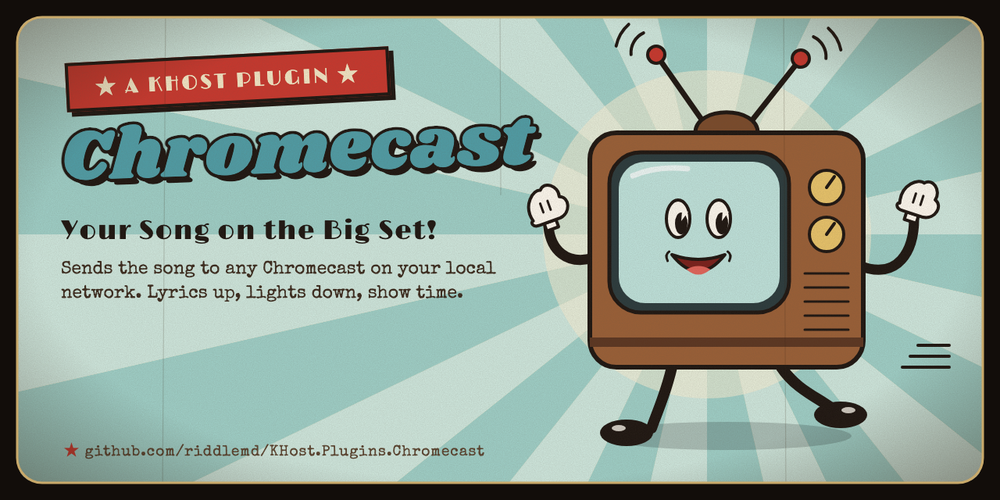

<div align="center">



[](https://github.com/riddlemd/KHost.Plugins.Chromecast/releases/latest)
[](https://github.com/riddlemd/KHost)
[](https://dotnet.microsoft.com/)
[](#install)
[](#how-it-works)
[](LICENSE)

[Features](#features) ·
[Install](#install) ·
[Usage](#usage) ·
[How it works](#how-it-works) ·
[Build from source](#build-from-source) ·
[License](#license) ·
[Tests](#tests)

</div>

---

Sends the song to a Chromecast receiver on the local network.

This is a [KHost](https://github.com/riddlemd/KHost) **display provider**: somewhere the song comes out that is not a
screen. A screen registers itself with the host over IPC and the host drives it; a receiver is the other way round, so
the host holds no handle on the device and asks this plugin for everything.

## Features

- **Finds receivers on the network** by mDNS, with a sweep length you can set.
- **Connects to one receiver at a time** and drives it with the transport calls playback makes.
- **Device list in KHost.** Discovery, connecting and disconnecting live behind a **Devices** button on the Plugins
  page, which also reports what the room is watching without being opened.
- **One portable zip** that runs on Windows, macOS and Linux.

## Install

**From KHost:** open **Plugins → Available**, install Chromecast, and restart KHost.

**By hand:** unzip a [release](https://github.com/riddlemd/KHost.Plugins.Chromecast/releases/latest) into its own
folder under KHost's `plugins/`, enable it on the Plugins page, and restart.

## Usage

Press **Devices** on the Plugins page. Discovery, connecting and disconnecting are all done from that list, and the
button shows what the room is watching without being opened.

### Settings

| Section | Setting | Default | |
|---|---|---|---|
| Discovery | Discovery time (seconds) | 5 | How long to sweep the network for receivers. |
| Discovery | Connect timeout (seconds) | 10 | How long a receiver has to answer before giving up. |

A save takes effect on the next sweep or connect, with no restart: the host serves the settings as options.

## How it works

### The device list

The device list is reached from the Plugins page, not from the console's Screens dialog. A plugin cannot ship markup,
so `ChromecastDeviceTable` describes a table (columns, a row per receiver, and what each button does) and the host
draws it from a `ShowPluginTableRequest`.

### What it implements

`IDisplayProvider`: discovery, one connection at a time, and the transport calls playback drives it with.

> [!NOTE]
> It deliberately implements no screen interface: a receiver plays on its own schedule and can never be held to the
> group's timeline, so it holds no role in the sync set. `ChromecastProviderSeparationTests` fails if it ever accepts
> an `IScreenCommand`.

## Build from source

```bash
dotnet build KHost.Plugins.Chromecast.slnx
dotnet test KHost.Plugins.Chromecast.slnx
```

The contracts (`KHost.Abstractions`, `KHost.Common`, 0.61.0) are package references, not a checkout beside this one.
They are not on nuget.org yet: pack them from the KHost repo with `./build/pack-contracts.sh` and register the local
feed once:

```bash
dotnet nuget add source ~/.nuget/khost-local -n khost-local
```

> [!WARNING]
> The test project takes the contracts **transitively**, through its `ProjectReference` to the plugin. Naming them as a
> `PackageReference` of its own would make the packages' `build/` targets trim them from its output, and every test
> would then fail to load `KHost.Abstractions`.

## Tests

The unit tests need no network. The `ChromecastReceiverIntegrationTests` drive a real CASTV2 receiver and skip unless
one is listening on `127.0.0.1:8009`; the [Chromecast-Emulator](https://github.com/riddlemd/Chromecast-Emulator)
serves that.

## License

[MIT](LICENSE) © 2026 Michael Riddle

Chromecast and Google Cast are trademarks of Google LLC. This plugin is not affiliated with or endorsed by Google.
